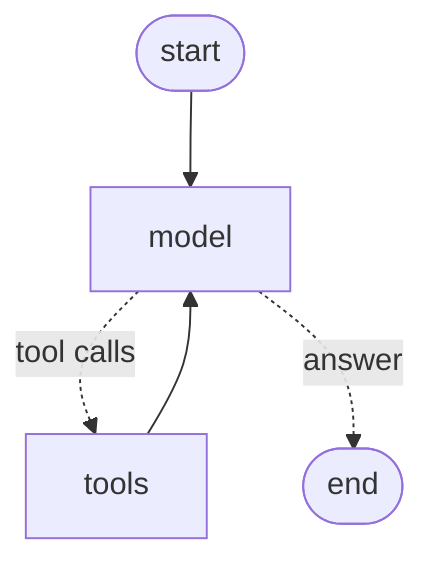

# SQL + RAG agent over Chinook

An agent built with **LangGraph** that answers natural-language questions about a music store (the [Chinook](https://github.com/lerocha/chinook-database) database). The agent explores the schema, writes and runs SQL queries, recovers from its own errors and explains the result. It runs **fully locally** with [Ollama](https://ollama.com) models (`qwen3:14b` by default).

It also has a **RAG** layer over the Wikipedia articles of the best-selling artists, so it can answer questions that combine sales data with information about the artists (e.g. *"Which artist has generated the most revenue, and where was the band formed?"*).

Example run:

```
User: Which support employee has generated the most sales through their assigned customers?

  → describe_tables(["Employee", "Customer", "Invoice"])
  → execute_query("SELECT e.FirstName, e.LastName, SUM(i.Total) ... GROUP BY e.EmployeeId ...")

Agent: Jane Peacock, with $833.04 in sales through her assigned customers...
```

## Architecture

A ReAct agent implemented as a LangGraph graph: at each step the model decides whether to call a tool or answer.



| Tool | What it does |
|---|---|
| `list_tables` | Lists the tables in the database |
| `describe_tables` | For a list of tables, returns their `CREATE TABLE` statement (columns, types, primary and foreign keys) and 5 sample rows |
| `execute_query` | Runs a SQL query and returns at most 20 rows |
| `search_wikipedia` | Semantic search over the artists' Wikipedia articles, optionally filtered by artist; returns the matching chunks with their source URL |

## Design decisions

- **Safety by design, not by prompt.** The connection is opened read-only (`mode=ro`): even if the model generates a `DELETE` or a `DROP`, SQLite rejects it. Write attempts are logged as warnings.
- **Errors the model can act on.** SQL errors (unknown column, syntax…) are returned to the model as a `ToolException` with the original message, so it can fix the query. Unexpected errors are not swallowed.
- **Context control.** `execute_query` returns at most 20 rows and says when it truncates, nudging the model towards `COUNT`, `GROUP BY` or `LIMIT`. Ollama silently truncates anything that doesn't fit in the context window (4096 tokens by default), so the context size is set explicitly (`num_ctx`).
- **Fewer loop iterations.** `describe_tables` accepts several tables in a single call, and the table names are included in the system prompt.
- **Schema with relationships.** The tool returns the `CREATE TABLE` statement instead of a plain column list, so the model sees the foreign keys, plus sample rows so it sees the real data formats (dates, country names…).
- **SQL injection in the tools.** Table names are validated against `sqlite_master` with parameterized queries before being used.
- **Concurrency.** `ToolNode` runs tools in threads, so each call opens its own connection.

## Evaluation

`evaluar_sql.py` runs the agent on **26 questions**, each with a hand-written reference query: counts, rankings, date aggregations, `LEFT JOIN` / `NOT EXISTS`, self-joins (`Employee.ReportsTo`) and relationships with non-obvious names (`Customer.SupportRepId`). Questions with ties or ambiguous wording were discarded.

**Main metric: execution accuracy**, as in the Spider and BIRD benchmarks. The last query the agent ran is re-executed and its result is compared with the reference result (extra columns are allowed, numbers are compared with a 0.01 tolerance, and row order only counts when the question asks for it).

### Results

`qwen3:14b` (Ollama, `temperature=0`, `num_ctx=16000`), 3 runs × 26 questions:

| Metric | Mean | Range across runs |
|---|---|---|
| **Execution accuracy** | **93.6 %** | 92.3 – 96.2 % |
| Correct final answer (natural language) | 97.5 % | 96.2 – 100 % |
| Tool calls per question | 1.9 | |
| Time per question (RTX 4060 Ti 16 GB) | 36 s | |

Even with `temperature=0` the results vary slightly between runs, which is why the evaluation is repeated. Full detail per question and run: [`results/eval_sql.json`](results/eval_sql.json).

**Failure analysis.** Only 2 of the 26 questions failed in any run:
- *"Who does employee Jane Peacock report to?"* (fails in 3/3 runs): the final answer is **correct**, but the agent takes it from the sample rows returned by `describe_tables` (which happen to include both employees) instead of running a query. Execution accuracy counts it as a failure because there is no SQL to check.
- *"Which country has generated the most revenue?"* (fails in 2/3 runs): the model writes the tool call **as plain text** (`<tool_call>{...}</tool_call>`) instead of emitting a real tool call, so the agent ends without answering. A known failure mode of local models with tool calling.

Bug found and fixed thanks to the evaluation: with `qwen3` on Ollama, the final answer sometimes ended up inside the reasoning field with empty content (18 of 26 answers in a first run). The model node now moves it to the content.

**Limitations**, to read the numbers correctly:
- Chinook is a well-known public database and the model has probably seen it during training (contamination), so results on a private database would likely be lower.
- 26 questions is a small sample.
- The metric only looks at the last query executed: if the agent answers correctly without running SQL (for example, from the sample rows returned by `describe_tables`), it counts as a failure.

## Known issues and next steps

Issues found while building and evaluating the agent, and how they are planned to be addressed:

| Issue | Observed | Planned fix |
|---|---|---|
| **Tool calls written as plain text.** The model sometimes outputs `<tool_call>{...}</tool_call>` as text instead of a real tool call, and the agent ends without an answer. | 2 of 78 answers (`qwen3:14b`); very frequent with `llama3.1:8b` | Detect the pattern in the model node and either parse it into a real tool call or ask the model to retry. |
| **Answers taken from sample rows.** When the 5 sample rows of `describe_tables` already contain the answer, the agent answers without running a query. Correct here, but unreliable in general (5 rows are not the full table). | 3 of 78 answers | Tell the model that sample rows are only for understanding the format, and evaluate the final answer as well as the SQL. |
| **SQL written from memory.** Occasionally the model skips `describe_tables` and guesses column names (e.g. `Track.ArtistId`, which does not exist). It recovers thanks to the error message, at the cost of extra steps. | Seen during development | The SQL error message already suggests calling `describe_tables`; next, include the schema of the involved tables directly in the error. |
| **Answer inside the reasoning field.** With `qwen3` on Ollama the final answer sometimes arrives in the reasoning field with empty content. | 18 of 26 answers before the fix | Worked around in the model node (fixed). To revisit if newer Ollama versions change this behaviour. |
| **Contamination.** The model probably knows Chinook, which inflates the results. | — | Evaluate on a version of the database with renamed tables and columns, and add more questions. |
| **Unbounded `describe_tables` output.** Asking for many tables at once can fill the context window (Ollama truncates silently). | Seen with all 11 tables at once | Limit the number of tables per call or the size of the output. |
| **Chunking edge cases.** No overlap between chunks; a single paragraph longer than the maximum is kept whole (one chunk of 2,323 characters); a short first section is not merged. | — | Split long paragraphs by sentence, evaluate adding overlap, handle the first-section case. |
| **Invented results.** In a mixed question, the model stopped halfway and answered *"the query returned 21 songs"* without having run any query (the real value is 45). | Seen once during manual testing | Add a grounding check before the agent ends: every number in the final answer must appear in a tool result, otherwise the model is sent back to run the query. Measure it in the mixed evaluation. |
| **Parallel calls that depend on each other.** The model sometimes searched Wikipedia for an artist before the SQL query that tells which artist it is, and guessed it wrong. | Seen during manual testing | Fixed in the system prompt (make dependent calls one at a time); to be confirmed with the mixed evaluation. |
| **Band members passed as artists.** The model passes `artist_name="Freddie Mercury"` and doesn't retry with the band. | Seen during manual testing | Fixed in code: for an unknown artist, the search falls back to all artists and warns that the results may not be about them. |

## RAG layer

- [x] `descargar_wikipedia.py`: downloads the articles of the best-selling artists. It disambiguates using the database itself: if all of an "artist's" tracks are TV genres, it looks for the TV series (*Lost* is the TV series, not the band *Lost*). It respects the Wikipedia API rate limits.
- [x] `chunking_script.py`: structure-aware chunking (sections and subsections), merging of short sections, splitting of long ones by paragraph (300–2,000 characters), a context header (artist and section) on every chunk, and metadata (`artist_id`, which links to the SQL database; section; source URL).
- [x] `rag.py`: embeddings (`qwen3-embedding:0.6b`) and a persistent vector store (Chroma) with the 810 chunks. Chunk IDs are stable (`{artist_id}_{n}`), so re-indexing doesn't duplicate them. The search can be filtered by artist (case-insensitive). If the artist has no articles (e.g. a band member like Freddie Mercury), it searches all artists and warns that the results may not be about that artist, listing the available ones.
  Quick check of cross-language retrieval: the same 6 questions in English and Spanish return the same top-3 chunks in 5 of 6 cases, with slightly higher distances in Spanish. The agent is still asked to search in English.
- [x] `search_wikipedia` tool for the agent. The system prompt tells it to use Wikipedia only when asked about an artist's history, members, origin or style, to make dependent calls one at a time (first SQL to find the artist, then Wikipedia), to cite the source URL and to say so when the documents don't contain the answer. The Chroma client is created once before the agent starts, because `ToolNode` runs tool calls in parallel threads and creating several clients at the same time fails.
- [ ] Evaluation with questions that combine SQL and RAG (several runs, as for the SQL agent).
- [ ] Decide the distance metric (Chroma's default is L2; cosine is usual for embedding models).
- [ ] Compare structure-aware chunking with *semantic chunking*.

## How to run it

Requirements: [uv](https://docs.astral.sh/uv/), [Ollama](https://ollama.com) and a GPU with about 12 GB of VRAM for `qwen3:14b`.

```bash
uv sync
ollama pull qwen3:14b

uv run src/descargar_datos.py          # Chinook database → data/chinook.sqlite
uv run src/agente.py                   # runs the agent on an example question
uv run src/evaluar_sql.py qwen3:14b 3  # evaluation (3 runs) → results/eval_sql.json

# RAG layer
uv run src/descargar_wikipedia.py 20   # articles of the 20 best-selling artists → data/wiki/
uv run src/chunking_script.py
ollama pull qwen3-embedding:0.6b
uv run src/rag.py                      # indexes the chunks into Chroma → data/chroma/ and runs test searches
```

Code comments are in English; variable names and the evaluation questions are in Spanish.

## Project structure

```
src/
├── agente.py               # tools and LangGraph agent
├── evaluar_sql.py          # evaluation (execution accuracy)
├── descargar_datos.py      # downloads the Chinook database
├── descargar_wikipedia.py  # downloads and disambiguates the artists' articles
├── chunking_script.py      # structure-aware chunking for the RAG layer
└── rag.py                  # indexing (embeddings + Chroma) and search
results/                    # evaluation results
data/                       # downloaded data (not versioned)
```

## Data and licenses

- Code: MIT license.
- [Chinook Database](https://github.com/lerocha/chinook-database), by Luis Rocha: MIT license.
- [Wikipedia](https://en.wikipedia.org) articles: [CC BY-SA 4.0](https://creativecommons.org/licenses/by-sa/4.0/). Every chunk keeps the URL of its source article.

The data is not included in the repository; it is downloaded by the scripts.
